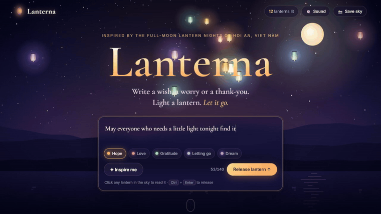
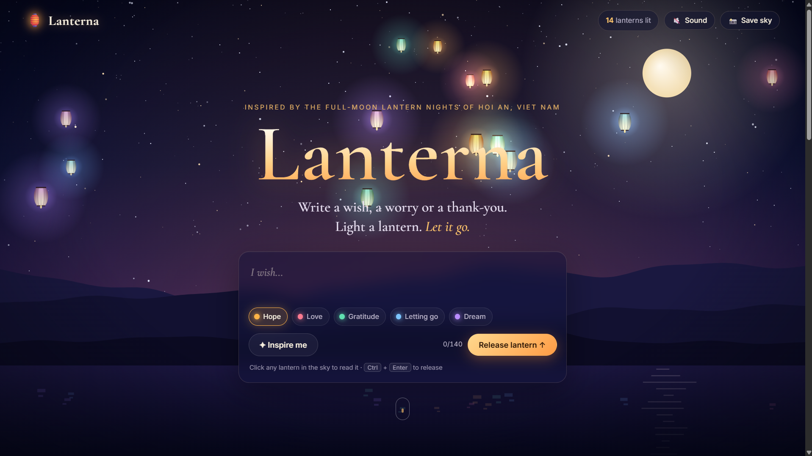
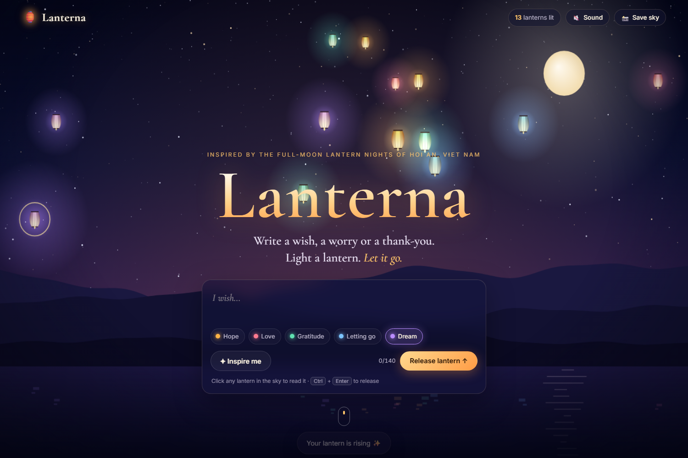
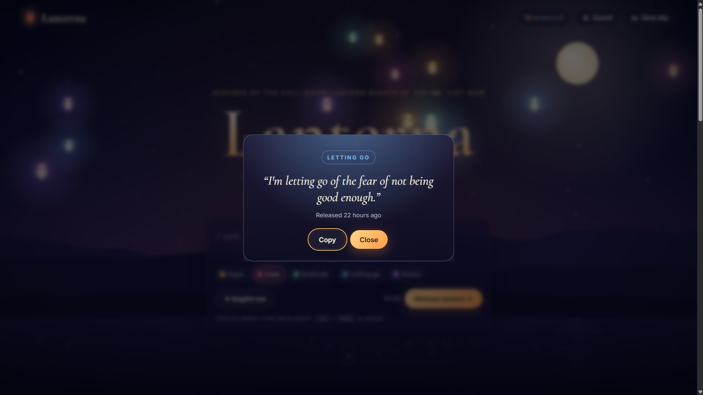
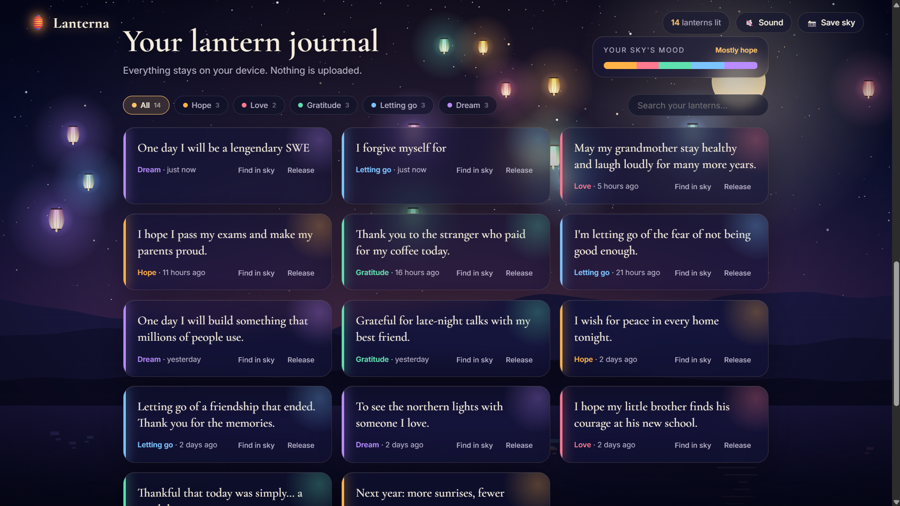

# 🏮 Lanterna

### Release a wish into the night sky

*An interactive night sky inspired by the full-moon lantern festival of Hoi An, Viet Nam.*

▶ Click the preview to watch the full demo video with narration (1 min).

---

## 🎬 Demo video
**[▶ Watch the demo video (MP4, 1 min, with narration)](assets/lanterna-demo.mp4)**

<!-- YouTube: replace this line with  -->

## 📸 Screenshots

| Home: a living night sky | Release a lantern |
|:---:|:---:|
|  |  |
| **Read any wish** | **Your lantern journal** |
|  |  |

## 🌕 About
Lanterna is an interactive night sky inspired by the full-moon lantern festival of **Hoi An, Viet Nam**. Once a month the town turns off its electric lights, and the river fills with paper lanterns carrying people's wishes. Lanterna brings that quiet moment to your screen. You write a wish, a worry or a thank-you, light a lantern and let it go.

Built for the **Build Your Own Website Hackathon 2026** by Roxten Studios.

## 💡 Why I built it
Most of the web asks for our attention. Lanterna gives you a small, calm place to put a thought into words and turn it into light. Writing something down and "releasing" it is a simple mindfulness and journaling habit. Lanterna makes that habit beautiful enough that you want to come back to it.

## ✨ Key features
- **Living night sky.** Twinkling stars, shooting stars, a glowing moon, layered mountains and a river that reflects the moon and every lantern. All of it is drawn live on HTML Canvas.
- **Release a lantern.** Write up to 140 characters, choose what it carries, then watch it lift off the river in a burst of sparks and rise to its own place in the sky.
- **Colour = meaning.** There are five lantern colours: Hope, Love, Gratitude, Letting go and Dream. Over time your sky becomes a map of how you've been feeling.
- **Read any lantern.** Click a lantern in the sky to open its wish on a glowing paper card, then copy or share it.
- **Lantern journal.** Every lantern is listed with filters by meaning, search, relative timestamps and a mood bar showing what your sky is "mostly" made of.
- **Find in sky.** Jump from a journal entry to its lantern, which pulses so you can spot it.
- **Release forever.** Delete a lantern and it drifts up out of the sky and fades away.
- **"Inspire me" prompts.** Guided sentence starters for when you don't know what to write.
- **Generative ambient sound.** A soft pad and wind-chime notes, plus a chime on every release. Everything is synthesized with the Web Audio API, with no audio files.
- **Save your sky.** Export the current sky as a PNG with your lantern count.
- **Private by design.** Wishes are stored only in your browser (localStorage). There is no account, no server and no tracking.
- **Responsive and accessible.** Works on phone and desktop, supports the keyboard (Ctrl+Enter to release), uses semantic HTML with ARIA labels, and respects `prefers-reduced-motion`.

## 🛠️ Tech
- HTML5, CSS3 (glassmorphism, `color-mix`, CSS animations) and vanilla JavaScript (ES2020)
- Canvas 2D for the whole scene, with seeded random positions so each lantern always returns to the same spot
- Web Audio API for the music and chimes
- localStorage for saving data
- No frameworks, no build step, no images or audio assets
- Hosted on GitHub Pages

## 🚀 Run locally
Open `index.html` in any modern browser. No build is needed.

## 📝 Disclosure
- **AI tools:** This project was built with help from **Claude** (Anthropic), an AI coding assistant. The narration in the demo video uses the built-in Windows text-to-speech voice, and the video's background music was synthesized with FFmpeg.
- **Fonts:** [Cormorant Garamond](https://fonts.google.com/specimen/Cormorant+Garamond) and [Inter](https://fonts.google.com/specimen/Inter) via Google Fonts (SIL Open Font License).
- **Templates / libraries:** None. All code is written from scratch.
- The `assets/` folder only holds screenshots and the demo video for this README. The website itself loads no images or audio files.
